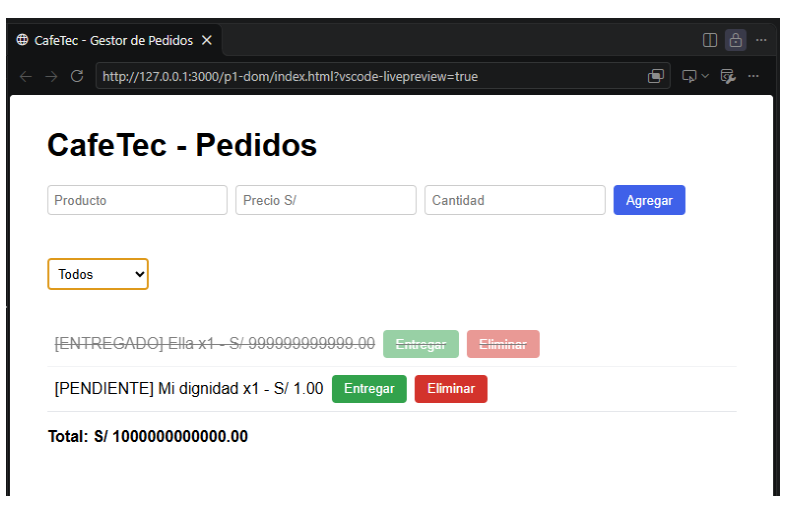
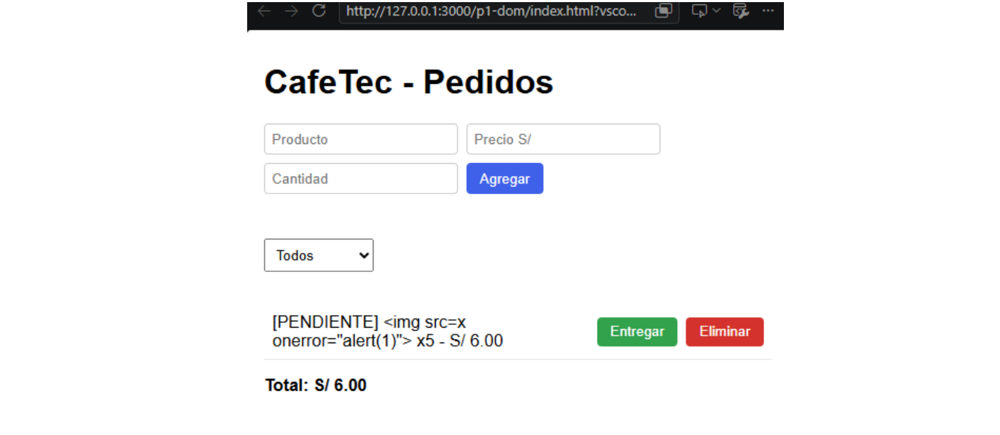
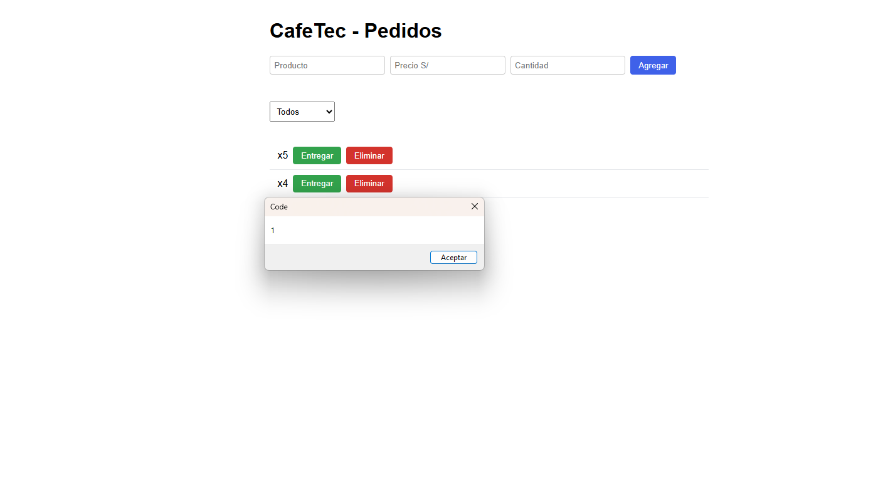
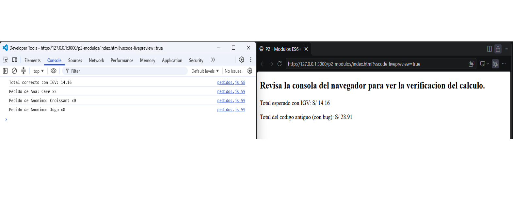
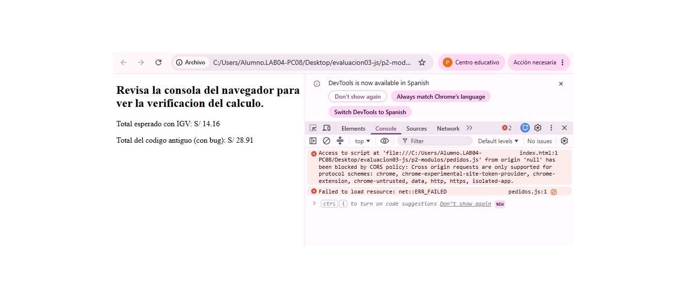
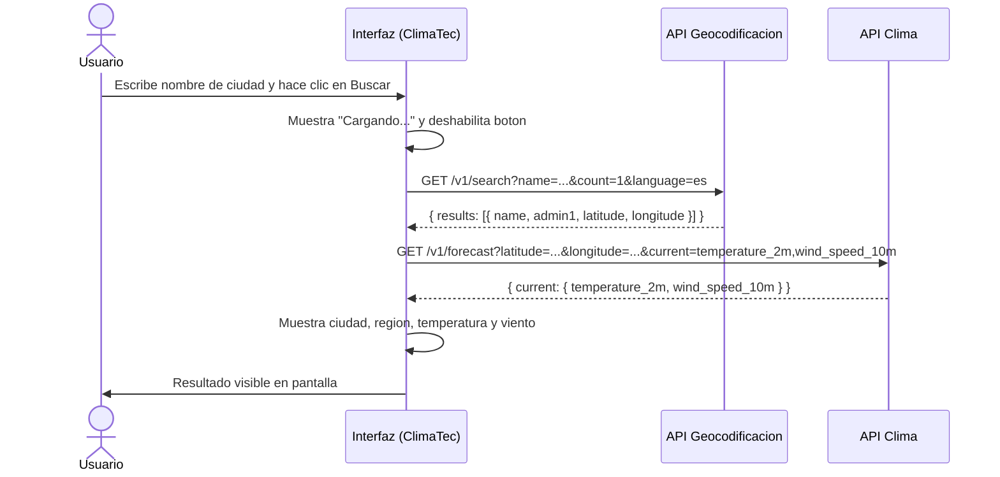
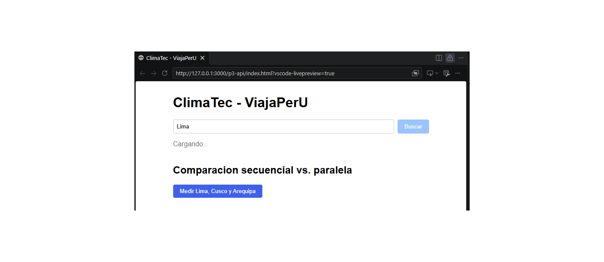
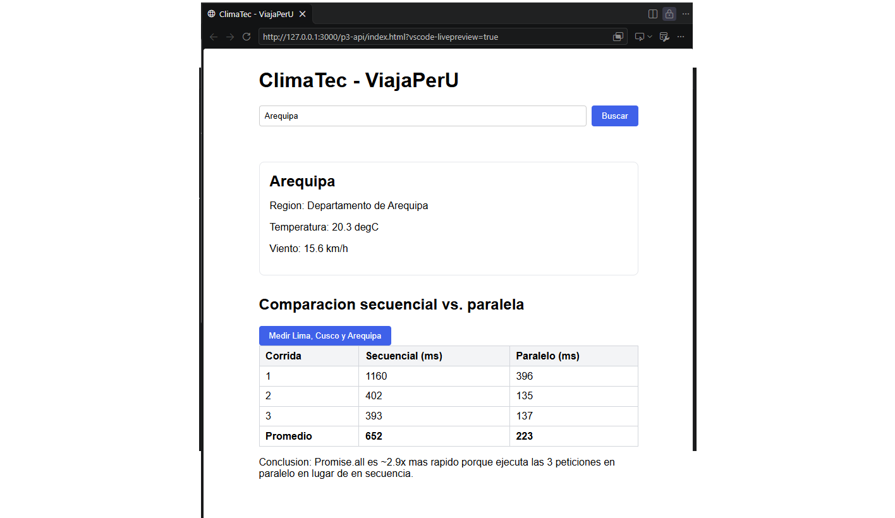
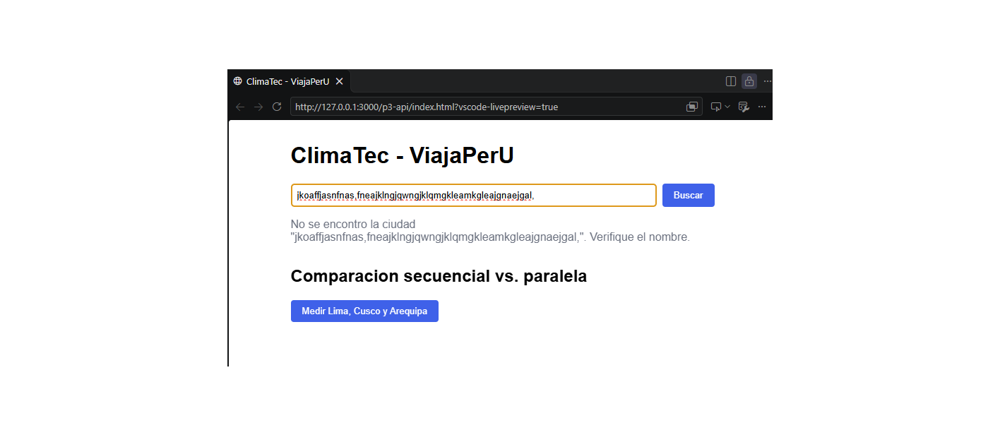
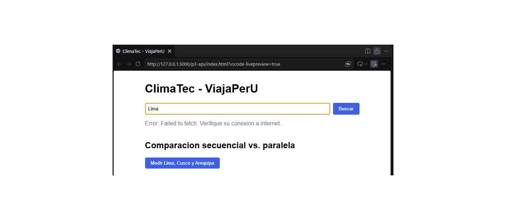

# evaluacion03-js

Evaluacion 03 - Diseno de Interfaces de Programacion Avanzado


---

## Tabla de contenidos

- [Descripcion](#descripcion)
- [Estructura del repositorio](#estructura-del-repositorio)
- [P1 - DOM, eventos y objetos](#p1---dom-eventos-y-objetos)
- [P2 - ES6+ y modulos](#p2---es6-y-modulos)
- [P3 - Fetch y async/await](#p3---fetch-y-asyncawait)
- [Bitacora de IA](#bitacora-de-ia)
- [Checklist de entregables](#checklist-de-entregables)
- [Conclusion](#conclusion)

---

## Descripcion

Proyecto que implementa un gestor de pedidos para la cafeteria **CafeTec** (P1),
una refactorizacion de codigo legado con ES6+ y modulos (P2), y un widget de
clima **ClimaTec** para la agencia **ViajaPerU** usando la API Open-Meteo (P3).

GitHub Pages: _[enlace al despliegue]_

---

## Estructura del repositorio

```
evaluacion03-js/
  p1-dom/
    index.html          Pagina principal del gestor de pedidos
    pedidos.js          Clase Pedido, arreglo y funciones de datos
    ui.js               Funciones de renderizado del DOM
    main.js             Punto de entrada y registro de eventos
    análisis.md         Tabla de eventos, modelo de objeto y justificaciones
  p2-modulos/
    index.html          Pagina de prueba de modulos
    codigo-antiguo.js   Codigo original del practicante (con bug)
    pedidos.js          Refactorizacion ES6+ con class y modulos
    cálculo.md   Calculo manual, explicacion del bug y tabla ES6+
  p3-api/
    index.html          Widget ClimaTec
    clima.js            Logica de consumo de Open-Meteo y medicion de tiempos
    analisis-api.md     Tabla de endpoints y revision de propuesta de IA
  img/                  Capturas de pantalla
  README.md             Este archivo
```

---

## P1 - DOM, eventos y objetos

### Tabla de eventos

| Elemento         | Evento | Accion                                                            |
|------------------|--------|-------------------------------------------------------------------|
| `#form-pedido`   | submit | Valida, crea Pedido, agrega al arreglo y llama render()          |
| `#filtro`        | change | Filtra el arreglo por estado y llama render()                    |
| `#lista-pedidos` | click  | Delegacion: detecta Entregar o Eliminar segun data-accion        |

### Fragmento clave: delegacion de eventos

```js
// Un solo listener en el padre maneja todos los botones dinamicos.
// Esto evita registrar un listener por cada boton al llamar render().
listaPedidos.addEventListener("click", (e) => {
  const btn = e.target.closest("[data-id]");
  if (!btn) return;
  const id = parseInt(btn.dataset.id, 10);
  const accion = btn.dataset.accion;
  if (accion === "entregar") {
    pedidos.find(p => p.id === id)?.marcarEntregado();
  } else if (accion === "eliminar") {
    eliminarPedido(id);
  }
  render(filtroSelect.value);
});
```

### Fragmento clave: render() seguro contra XSS

```js
// Usé createElement + textContent en lugar de innerHTML con datos del usuario.
// innerHTML interpreta "" como HTML ejecutable.
// textContent lo muestra como texto literal, sin riesgo de inyeccion.
function crearFilaPedido(pedido) {
  const li = document.createElement("li");
  const texto = document.createElement("span");
  texto.textContent =
    `[${pedido.estado.toUpperCase()}] ${pedido.producto} x${pedido.cantidad} - S/ ${pedido.subtotal().toFixed(2)}`;
  li.appendChild(texto);
  return li;
}
```

### Capturas P1





---

## P2 - ES6+ y modulos

### Calculo manual del error || vs ??

| Pedido    | cantidad | `cantidad \|\| 1` | `cantidad ?? 0` |
|-----------|----------|--------------------|-----------------|
| Cafe      | 2        | 2                  | 2               |
| Croissant | 0        | **1** (BUG)        | 0               |
| Jugo      | undefined| 1                  | 0               |

Con `||`: total = (6*2 + 4.5*1 + 8*1) * 1.18 = 24.5 * 1.18 = **S/ 28.91** (incorrecto)

Con `??`: total = (6*2 + 4.5*0 + 8*0) * 1.18 = 12 * 1.18 = **S/ 14.16** (correcto)

### Tabla de caracteristicas ES6+

| Caracteristica      | Donde se uso                   | Por que                                              |
|---------------------|--------------------------------|------------------------------------------------------|
| const / let         | Todas las variables            | Evita re-declaracion y clarifica el scope            |
| Funciones flecha    | calcularTotal, resumen, reduce | Sintaxis concisa; no crea su propio `this`           |
| Template literals   | resumen(), mensajes            | Legibilidad sobre concatenacion con +                |
| Desestructuracion   | Constructor de Pedido          | Extrae propiedades con defaults en la firma          |
| reduce()            | calcularTotal                  | Acumulacion funcional sin variable externa           |
| ?. (optional chain) | pedido.cliente?.nombre         | Evita TypeError con objetos opcionales               |
| ?? (nullish coalesce)| cantidad ?? 0                 | Distingue null/undefined de valores falsy como 0    |
| class               | class Pedido                   | Encapsula datos y metodos en una estructura          |
| Spread (...)        | actualizarPedido               | Actualiza sin mutar el arreglo original              |
| ES Modules          | import/export en los tres .js  | Separacion de responsabilidades                      |

### Fragmento clave: refactorizacion

```js
// calcularTotal refactorizado: const, flecha, reduce, IGV al final.
const IGV = 0.18;
export const calcularTotal = (listaPedidos) => {
  const subtotal = listaPedidos.reduce((acc, p) => acc + p.subtotal(), 0);
  return subtotal + subtotal * IGV;
};

// resumen refactorizado: ?. para acceso seguro, ?? para fallback, template literal.
export const resumen = (pedido) => {
  const cliente = pedido.cliente?.nombre ?? "Anonimo";
  return `Pedido de ${cliente}: ${pedido.producto} x${pedido.cantidad}`;
};
```

### Error con file://

Al abrir con doble clic el navegador muestra en la consola:

```
Access to script at 'file:///...pedidos.js' from origin 'null'
has been blocked by CORS policy
```

Causa: los modulos ES requieren HTTP para las cabeceras CORS.
Solucion: servir con Live Server (http://127.0.0.1:5500).

### Captura P2




### Justificacion del tipo de export

Se usaron **named exports** en todos los modulos porque cada archivo expone
multiples funciones o clases que se importan selectivamente. El `export default`
se reserva para modulos que representen una sola entidad principal (por ejemplo,
un componente de UI que es la unica exportacion del archivo). Usar named exports
facilita el tree-shaking del bundler y hace explicito en el punto de importacion
exactamente que se esta usando.

---

## P3 - Fetch y async/await

### Tabla de endpoints Open-Meteo

| Endpoint                             | Parametros que usa                                       | Campos de la respuesta que necesita              |
|--------------------------------------|----------------------------------------------------------|--------------------------------------------------|
| geocoding-api.open-meteo.com/v1/search | name, count=1, language=es                             | results[0]: name, admin1, latitude, longitude    |
| api.open-meteo.com/v1/forecast       | latitude, longitude, current=temperature_2m,wind_speed_10m | current: temperature_2m, wind_speed_10m        |

### Diagrama de flujo (Mermaid)



### Fragmento clave: async/await con manejo de errores

```js
async function buscarYMostrar(nombreCiudad) {
  elEstado.textContent = "Cargando...";
  btnBuscar.disabled = true;
  try {
    const ciudad = await buscarCiudad(nombreCiudad);
    if (!ciudad) {
      elEstado.textContent = `No se encontro "${nombreCiudad}".`;
      return;
    }
    const clima = await obtenerClima(ciudad.latitude, ciudad.longitude);
    // mostrar datos...
  } catch (err) {
    // Captura errores de red y lanzados con throw.
    elEstado.textContent = `Error: ${err.message}`;
  } finally {
    // Se ejecuta siempre: reactiva el boton sin importar si hubo error.
    btnBuscar.disabled = false;
  }
}
```

### Por que fetch no lanza error ante 404 o 500

fetch() solo rechaza la promesa ante fallas de red (sin conexion, DNS, timeout).
Una respuesta HTTP 404 o 500 es una respuesta valida del servidor; la red funcionó.
Por eso se debe verificar `response.ok` manualmente antes de leer el cuerpo.

### Promise.all vs Promise.allSettled

Se usa **Promise.allSettled** cuando se miden las tres ciudades juntas porque
permite mostrar los resultados disponibles aunque una ciudad falle. Promise.all cancelaria toda la operacion ante el primer error.
Para el caso de una sola ciudad (busqueda del usuario) se usa el flujo secuencial
con await y try/catch porque los dos pasos son dependientes entre si.

### Tabla de tiempos

| Corrida | Secuencial (ms) | Paralelo (ms) |
|---------|-----------------|---------------|
| 1       |       409       |     402        |
| 2       |      404        |     138        |
| 3       |      407        |     137        |
| Promedio|      407        |      225       |

Conclusion: Promise.all es mas rapido porque las tres peticiones se inician
al mismo tiempo y el tiempo total es el de la peticion mas lenta, no la suma
de las tres. Los valores exactos se obtienen ejecutando el boton "Medir Lima,
Cusco y Arequipa" en la pagina y registrando los resultados de la consola.

### Capturas P3






---

## Bitacora de IA

| #  | Pregunta | IA usada | Que propuso la IA                                                                 | Decision | Por que                                                                                                         |
|----|----------|----------|------------------------------------------------------------------------------------|:--------:|-----------------------------------------------------------------------------------------------------------------|
| 1  | P1       | Claude   | Usar innerHTML con template literals para construir cada fila del pedido           | Corrigio | Se probo insertando `` como producto; con innerHTML el script se ejecuto. Se cambio a createElement + textContent. |
| 2  | P1       | Claude   | Agregar un listener a cada boton Entregar/Eliminar dentro de render()              | Rechazo  | Se verifico que al llamar render() repetidamente los botones acumulan listeners. Se implemento delegacion con un solo listener en #lista-pedidos. |
| 3  | P2       | Claude   | Refactorizacion completa manteniendo `\|\|` para el fallback de cantidad           | Corrigio | Se ejecuto `calcularTotal(pedidosEjemplo)` en consola: devolvio 28.91. El calculo manual da 14.16. Se cambio `\|\|` por `??`. |
| 4  | P2       | Claude   | Usar export default para todas las funciones del modulo pedidos.js                 | Corrigio | Documentacion de MDN indica que export default es para la exportacion principal unica. Con multiples named exports el codigo de importacion es mas explicito y facilita el tree-shaking. |
| 5  | P3       | Claude   | Usar `current_weather=true` y leer `data.current_weather.temperature`             | Corrigio | Se leyo la documentacion oficial en open-meteo.com: el parametro actual es `current=temperature_2m,...` y el campo es `data.current.temperature_2m`. Se verifico ejecutando la peticion en la consola del navegador y revisando el JSON real. |
| 6  | P3       | Claude   | Usar Promise.all para todas las consultas incluyendo la busqueda del usuario       | Corrigio | Se probo con "Xyzabc" como una de las ciudades: Promise.all lanzo error y no se mostro ningun resultado. Se cambio a Promise.allSettled para la comparacion multiple y se mantuvo await secuencial para la busqueda individual. |

---

## Checklist de entregables

- [x] P1: tabla de eventos (p1-dom/análisis.md)
- [x] P1: modelo de objeto Pedido con metodos subtotal() y marcarEntregado()
- [x] P1: arreglo de pedidos y funcion render() basada en el arreglo
- [x] P1: validacion con preventDefault() y mensajes en #mensaje (sin alert)
- [x] P1: delegacion de eventos con closest() y data-id
- [x] P1: justificacion de la delegacion por escrito
- [x] P1: prueba de seguridad innerHTML vs textContent documentada
- [x] P1: revision critica de la propuesta de la IA para render()
- [x] P2: calculo manual del total correcto con IGV
- [x] P2: explicacion del bug || vs ??
- [x] P2: refactorizacion con const/let, flechas, template literals, desestructuracion, reduce, ?., ??
- [x] P2: class Pedido con spread para actualizacion inmutable
- [x] P2: organizacion en modulos ES (pedidos.js, ui.js, main.js)
- [x] P2: justificacion del tipo de export (named vs default)
- [x] P2: captura del error file:// y explicacion documentada
- [x] P2: tabla de caracteristicas ES6+ con justificaciones
- [x] P3: tabla de endpoints leida de la documentacion oficial
- [x] P3: buscarCiudad() y obtenerClima() con async/await
- [x] P3: estado de carga y boton deshabilitado durante la peticion
- [x] P3: manejo de errores con try/catch/finally
- [x] P3: verificacion de response.ok y ciudad no encontrada
- [x] P3: explicacion de por que fetch no lanza error en 404/500
- [x] P3: medicion de tiempos secuencial vs Promise.all con performance.now()
- [x] P3: decision y prueba de Promise.all vs Promise.allSettled
- [x] P3: revision de la propuesta de la IA contra la documentacion
- [x] P4: README con titulo, descripcion, badges y tabla de contenidos
- [x] P4: diagrama Mermaid del flujo de P3
- [x] P4: bitacora de IA con al menos 6 entradas
- [x] P4: checklist de entregables

---

## Conclusion

Las decisiones tecnicas mas importantes de este proyecto fueron tomadas de forma
critica, no delegadas a la IA. En P1, la decision de usar delegacion de eventos
surgio de analizar el ciclo de vida del DOM: los botones se crean dinamicamente en
cada llamada a render(), por lo que asignarles listeners individuales provocaria
acumulacion de handlers con cada renderizado. La delegacion en el elemento padre es
la solucion correcta independientemente de lo que proponga la IA. Del mismo modo,
la eleccion de textContent sobre innerHTML no fue una sugerencia que se acepto, sino
una decision respaldada por una prueba concreta: se ingreso ``
como nombre de producto y se comprobO visualmente que innerHTML lo ejecuta mientras
textContent lo muestra como texto.

En P2, el error del operador `||` no fue detectado por la IA de forma espontanea:
su primera propuesta de refactorizacion mantuvo `||` intacto. Solo al ejecutar el
codigo refactorizado y comparar el resultado (28.91) con el calculo manual (14.16)
quedo claro que el bug persistia. La verificacion numerica, no la lectura del codigo
de la IA, fue la que detecto el problema.

En P3, la IA propuso el campo `current_weather` que figura en ejemplos antiguos de
la documentacion pero que ya no es el parametro recomendado. Verificar contra la
documentacion oficial de Open-Meteo y ejecutar la peticion en la consola para
inspeccionar el JSON real fueron los pasos que permitieron corregir el nombre de los
campos. La IA resulto util para estructurar el flujo async/await y el esqueleto del
try/catch/finally, pero no reemplazo la lectura directa de la documentacion.

En general, la IA acelero la escritura de codigo repetitivo y la estructura inicial
de los modulos, pero todas sus propuestas fueron verificadas antes de aceptarse.
Los casos donde fue menos util fueron precisamente los mas importantes para la
correctitud del sistema: el bug logico de `||` vs `??`, la seguridad XSS y los
nombres exactos de los campos de la API.
